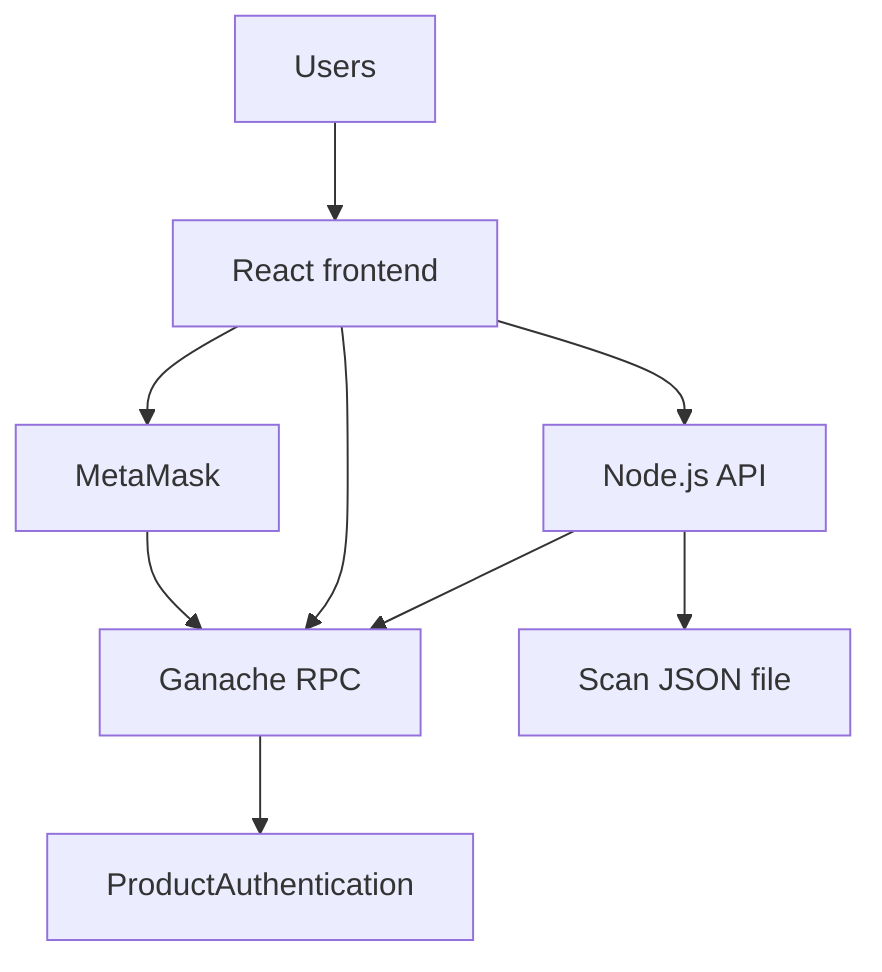
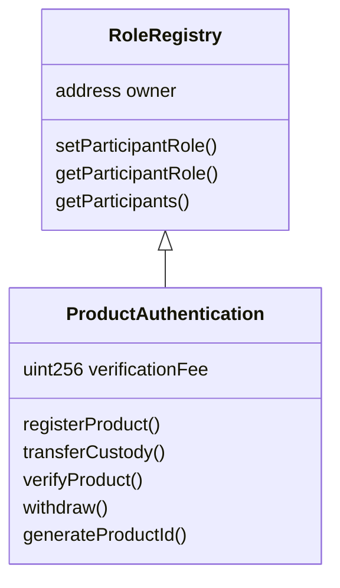
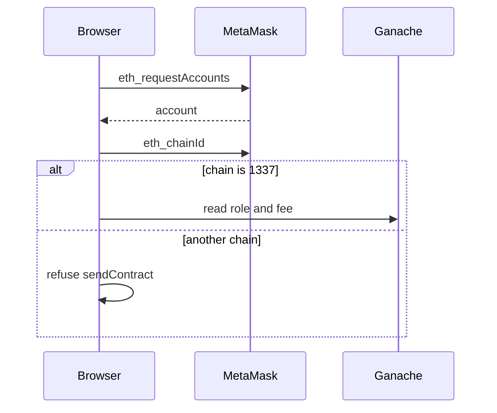
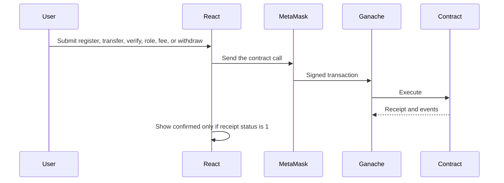

# Architecture

## System



Writes are signed in MetaMask and sent to Ganache. Reads of product state use ethers.js against the Ganache RPC, from the browser and from the API. The API never holds a key and never sends a transaction. Scan analytics are off-chain and are labeled as such.

## Technology stack

Ethereum-compatible Ganache, Solidity 0.8.20, Truffle, MetaMask, React, Vite, ethers.js 6, Node.js, and Express. Product identity is a QR code containing a verification URL. Persistent product state is the contract. Scan analytics use `backend/data/scans.json`.

## Components

| Component | Responsibility |
| --- | --- |
| `RoleRegistry` | Owner, role mapping, participant list, `ParticipantRoleUpdated` |
| `ProductAuthentication` | Products, history, fees, verification, withdrawal |
| Truffle migrations | Deploy with a 0.001 ETH fee and write `deployment.json` |
| `scripts/sync-abi.js` | Copy ABI and deployment into `frontend/public` |
| Backend client | Read-only contract calls and event queries |
| Scan services | Hash client identifiers, score repeated scans |
| React wallet context | Connection, network guard, signed calls |
| Pages | Admin, supply-chain dashboards, register, transfer, verify, scan, history, activity |

## Smart contract



`Product` stores name, batch, product id, manufacturer, custodian, registration time, verification count, existence, and status. `HistoryEntry` stores actor, from, to, timestamp, and an action code. Mappings key both structures by product id.

Role transitions:

- Manufacturer may register and may transfer only while status is with the manufacturer, and only to a distributor.
- Distributor may transfer only while status is with the distributor, and only to a retailer.
- Any other sender is rejected.
- Setting a role to none removes that wallet's authority. The address stays in the participant list.

Fee changes apply to later `verifyProduct` calls. ETH already held by the contract is unchanged. The fee must be greater than zero, at most 1 ETH, and different from the current fee.

## Backend

```text
backend/src/app.js              Express app
backend/src/server.js           Listen and start the event poller
backend/src/config/index.js     Environment and labels
backend/src/blockchain/client.js
backend/src/controllers/       HTTP handlers
backend/src/routes/index.js
backend/src/services/          Scans, analytics, event monitor
backend/src/middleware/        404 and error JSON
```

The event monitor polls `queryFilter` every 15 seconds and logs new events. It does not write product state.

## Frontend

```text
frontend/src/main.jsx           Router and wallet provider
frontend/src/App.jsx            Routes
frontend/src/context/WalletContext.jsx
frontend/src/services/contract.js
frontend/src/pages/             Dashboards and flows
frontend/src/components/        Forms, QR, scanner, record, transaction status
```

Vite proxies `/api` to `http://127.0.0.1:4000`.

## Database

There is no database server. `backend/data/scans.json` stores hashed scan rows for analytics. If the file is deleted, product registration and custody remain on Ganache. Cached scans are never treated as the product record. A future MongoDB collection would follow the same rule: the confirmed contract state wins on conflict.

## API

| Method | Path | Success | Notes |
| --- | --- | --- | --- |
| GET | `/api/health` | 200 | 503 when the RPC call throws |
| GET | `/api/config` | 200 | ABI and address. No key |
| GET | `/api/products/:productId` | 200 | 400 bad id, 404 unknown |
| GET | `/api/products/:productId/history` | 200 | `source: blockchain` |
| GET | `/api/products/:productId/verify` | 200 | Read only. `paymentSubmitted` is false |
| POST | `/api/products/scan` | 201 | 404 if the product is not on-chain |
| GET | `/api/products/:productId/scans` | 200 | Hashed client prefix only |
| GET | `/api/events` | 200 | Optional `productId` and `limit` |
| GET | `/api/participants/:address` | 200 | 400 if the address is malformed |

## Wallet flow



Account and chain events from MetaMask refresh the header. `sendContract` checks the chain again immediately before a write.

## Transaction flow



Gas is the network fee MetaMask estimates. The 0.001 ETH verification fee is `msg.value` on `verifyProduct` only.

## Data flow

Registration hashes the serial in Solidity and in the form preview with the same `abi.encode` plus `keccak256` rules. The QR payload is `{origin}/verify?pid={productId}`. Verification reads `productExists`, `getProduct`, `getHistory`, and `getVerificationFee` from Ganache. The scan POST is a separate analytics write.

## Security architecture

- `onlyOwner`, `onlyManufacturer`, and custodian checks sit on the contract.
- `existingProduct` guards transfers, verification, and reads that require a record.
- `nonReentrant` wraps withdrawal. `ReentrancyBlocked` and `EthTransferFailed` are custom errors. The reentrancy test uses `contracts/test/ReentrancyAttacker.sol`.
- `receive()` rejects bare ETH so a payment cannot skip `verifyProduct`.
- The API error handler returns JSON and does not attach stack traces to the client.
- Frontend transaction state stays at "awaiting signature" or "waiting for receipt" until a successful receipt exists.
